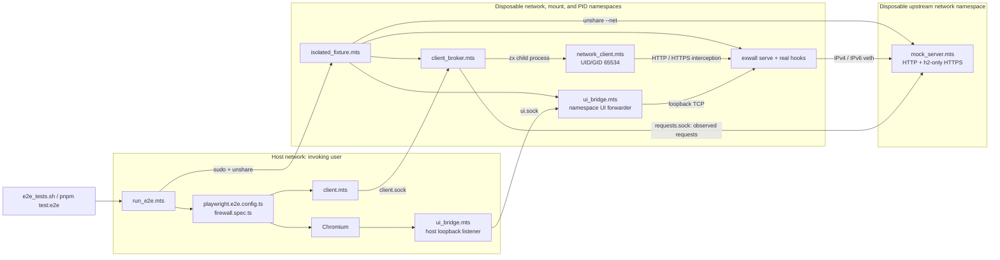

# Playwright tests

Playwright and Chromium run on the development host as the invoking user. The
production exwall binary, startup/stop hooks, and restricted network clients run
in disposable Linux namespaces. A separate upstream network namespace contains
local HTTP and HTTP/2 servers. Neither isolated network has an internet route.

The former Python integration suite is fully ported to this runner. Protocol
tests use local sockets and temporary CA material; firewall and lifecycle tests
use the isolated fixture. No test calls Python.

## Running the tests

Install project dependencies and Chromium once:

```sh
mise exec -- pnpm install
mise exec -- pnpm exec playwright install --with-deps chromium
```

Run the real app and firewall E2E suite:

```sh
./e2e_tests.sh
# Equivalent, using the pinned runtime:
mise exec -- pnpm test:e2e
```

The launcher builds the embedded frontend and Rust binary first. After a build,
`./e2e_tests.sh --no-build` reuses `target/debug/exwall`. The full
`./integration_tests.sh` runs this same unified Playwright suite. Both scripts
accept Playwright arguments after the optional `--no-build`, for example:

```sh
./integration_tests.sh --no-build network.spec.ts
./e2e_tests.sh --no-build --grep "local proxy protocols"
```

The full E2E suite requires Linux, root or passwordless `sudo`, and `unshare`,
`nsenter`, `ip`, `mount`, `sysctl`, `iptables`, `ip6tables`, their `*-save` tools,
`ping`, curl with HTTP/2, `/usr/lib/systemd/systemd`, and `openssl`. Missing
privileges, namespace support, or Chromium fail the run.
Node's pinned version executes `.mts` files directly. Child commands are spawned
through `zx`, with argument arrays quoted by its template API.

## Helper files and imports

All Playwright support scripts live in `tests/playwright_helpers/`.
`package.json` maps their imports:

```json
{
  "imports": {
    "#playwright_helpers/*": "./tests/playwright_helpers/*"
  }
}
```

For example:

```ts
import { networkRequest, fixtureRules } from "#playwright_helpers/client.mts";
import { startMockServer } from "#playwright_helpers/mock_server.mts";
```

| File | Role |
| --- | --- |
| [run_e2e.mts](tests/playwright_helpers/run_e2e.mts) | Host entry point: builds the app, snapshots host state, starts the isolated fixture, exposes its UI, launches Playwright, and verifies cleanup. |
| [isolated_fixture.mts](tests/playwright_helpers/isolated_fixture.mts) | Creates temporary accounts/hosts views, configuration, rules, CA, veth networking, exwall, hooks, and private socket services. |
| [mock_server.mts](tests/playwright_helpers/mock_server.mts) | Reusable HTTP/HTTP2 upstream and executable peer-namespace server. Records requests and supports custom pathname/method routes. |
| [client_broker.mts](tests/playwright_helpers/client_broker.mts) | Receives private Unix-socket requests, reads persisted rules/upstream records, and launches the fixed-identity client. |
| [network_client.mts](tests/playwright_helpers/network_client.mts) | Verifies its network namespace, clears supplementary groups, drops to UID/GID 65534 (`nobody`), and performs HTTP/HTTPS, TCP, DNS, certificate, or ICMPv6 checks. Fixed bypass/admin roles support positive controls. |
| [test_fixtures.mts](tests/playwright_helpers/test_fixtures.mts) | Shared Playwright test exports: local proxy ownership, optional browser authentication, failure artifacts, and UI/network policy isolation. |
| [client.mts](tests/playwright_helpers/client.mts) | Importable test API: `networkRequest()`, `fixtureRules()`, `upstreamRequests()`, `writeFixtureRules()`, `fixtureOperation()`, and `fixtureCheck()`. |
| [ui_bridge.mts](tests/playwright_helpers/ui_bridge.mts) | Relays host loopback TCP through a Unix socket to exwall's namespace-local UI. |
| [namespace_safety.mts](tests/playwright_helpers/namespace_safety.mts) | Isolation guards and host/firewall/sysctl snapshots. |
| [processes.mts](tests/playwright_helpers/processes.mts) | `zx` command execution, JSON readiness messages, service readiness, and bounded child shutdown. |
| [protocol.mts](tests/playwright_helpers/protocol.mts) | Shared request/result types and validation of broker network operations. |

[playwright.e2e.config.ts](playwright.e2e.config.ts) consumes the addresses and
paths provided by `run_e2e.mts`. It rejects direct execution without the fixture
and checks that Playwright remains in the launcher's host network namespace.
[ui/e2e/firewall.spec.ts](ui/e2e/firewall.spec.ts) contains the browser scenarios
and assertions about the effects of saved rules.

## Startup and connections

`run_e2e.mts` uses root or passwordless sudo to execute `isolated_fixture.mts`
under:

```sh
unshare --net --mount --pid --fork --mount-proc --kill-child \
  --propagation private node .../isolated_fixture.mts ...
```

The network namespace isolates interfaces, routes, firewall rules, and network
sysctls. The mount namespace permits private `/etc/hosts` and `/etc/passwd`
bind mounts. It shares the filesystem, so application state uses temporary paths.
The PID namespace contains the fixture's descendant processes. The isolation
guard refuses hook execution if either network or mount identity matches the
host, or if the fresh network already contains interfaces beyond loopback.

The fixture starts `mock_server.mts` under another `unshare --net`, waits for its
isolation message, connects the two networks with an IPv4/IPv6 veth pair, and then
permits the upstream to bind port 80 and 443. It starts exwall and applies the
real hooks with root as the proxy identity. Each network client then drops to
`nobody`, which is subject to interception and filtering.

The fixture announces two private socket paths over stdout. The host launcher
waits for that readiness message before starting Playwright:

- `ui.sock` carries real UI/API traffic. Chromium connects to an ephemeral host
  loopback TCP port; `ui_bridge.mts` relays it to namespace-local loopback. No
  host IP route or firewall modification is needed.
- `client.sock` carries test commands. `client_broker.mts` accepts only fixture
  reads, dedicated rules-file writes, named lifecycle checks, and validated
  network operations. It controls the client identity and CA and
  returns JSON. The sockets are in a private temporary directory and are owned
  by the invoking user.



## Network assertions

Tests make network requests from the test function through the imported helper:

```ts
const response = await networkRequest({
    operation: "http",
    url: "https://example.com/browser",
    method: "GET",
});
```

A completed HTTP exchange returns:

```json
{"result":{"status":403,"body":"exwall: no allow rule matched\n"}}
```

A transport failure instead returns `error` and `error_type`. HTTP denials must
produce 403; a timeout, TLS error, or connection failure does not count as a
successful denial assertion. HTTPS uses the fixture CA with certificate
verification enabled. It does not disable TLS verification.

The tests poll actual traffic after UI saves because the rules watcher reloads
asynchronously. Allowed replies must identify the local upstream and the
requested method. HTTPS replies must report `httpVersion: "2.0"`, demonstrating
that exwall connected to the h2-only upstream. `upstreamRequests()` provides the
upstream's observations so tests can assert denied paths never arrived there.

Network tests edit `20-network.toml` in the temporary rules directory via
`writeFixtureRules(toml)`. Passing `null` deletes that file. The broker restricts
writes to this one fixture-owned path. Tests use `expect.poll` against real
traffic to wait for the production watcher, and remove their policy after each
case. They do not need to save through the UI or signal the server for rule
changes. Configuration reload tests still use SIGHUP, and lifecycle checks use
explicit hook/process operations.

```ts
await writeFixtureRules('[[allow]]\ndomain = "example.com"\n');
await expect.poll(async () => {
    const response = await networkRequest({ operation: "http", url: "https://example.com/" });
    return typeof response.result === "object" ? response.result.status : response.error;
}).toBe(200);
await writeFixtureRules(null);
```

The migrated coverage is organized as follows:

| Former suite | Playwright coverage |
| --- | --- |
| `integration.py` | `protocol.spec.ts`: HTTP validation/filtering, direct TLS and CONNECT, upstream trust, HTTP/1 fallback, downstream HTTP/2, streaming/trailers, dual-stack DNS/UI assets, API sessions/basic auth, reloads, and access logs. |
| `mitmwall_namespace.py` | `network.spec.ts` and retained `network-cases.json`: domain/method/path rules, injection, direct TCP denial with positive controls, user/network bypass certificates, DNS redirects, loopback/ICMPv6, control services, and lifecycle checks. |
| `firewall_namespace.py` | Named `ordering`, `state`, and `logging` checks: both firewall families, command logs, CIDR normalization, jump/bypass order, idempotence, invalid-file stop, and exact restoration. Source-scoped REDIRECT recovery is exercised by `transparent`. |
| `transparent_namespace.py` | `transparent.mts`: IPv4/IPv6 HTTP/TLS original destinations, header injection, denials, and routing to authorized hosts rather than attackers. |
| `systemd_lifecycle.py` | `systemd_lifecycle.mts`: private production unit, malformed policy retries, SIGKILL restart, listener startup failure, fail-closed stop, and explicit restoration. |
| Python clients/upstreams/runner | `dns.mts`, `network_client.mts`, `mock_server.mts`, `proxy_fixture.mts`, and `run_e2e.mts`; host snapshots and namespace guards remain mandatory. |

Privileged assertions run through a fixed list of `fixtureCheck` names. The
broker cannot execute caller-supplied shell commands. Failures propagate to the
owning Playwright test. Shared test fixtures in
`tests/playwright_helpers/test_fixtures.mts` own local proxies, optional browser
authentication, failure artifacts, and shared UI/network policy restoration.
Namespace lifecycle helpers retain their own hook and resource cleanup.

The suite also covers login/logout, saved rules, failed validation preserving active
policy, conflicting saves, HTTP/HTTPS allow/deny changes, IPv6, HTTPS header
injection, pathname patterns/regexes, method restrictions, query strings, and POST
bodies.

## Reusing the mock server

Importing `mock_server.mts` does not start servers or create namespaces. Its
`startMockServer()` API can be used independently:

```ts
import { readFile } from "node:fs/promises";
import { startMockServer } from "#playwright_helpers/mock_server.mts";

const upstream = await startMockServer({
    host: "127.0.0.1",
    tls: {
        key: await readFile("/path/to/test-key.pem"),
        cert: await readFile("/path/to/test-cert.pem"),
    },
    routes: [
        { pathname: "/health", method: "GET", body: { healthy: true } },
        { pathnameRegex: "^/items/[0-9]+$", method: "POST", status: 201 },
    ],
});

try {
    // upstream.port is an ephemeral port; upstream.requests records arrivals.
} finally {
    await upstream.close();
}
```

Without `tls`, the server speaks plain HTTP/1. With `tls`, it speaks HTTP/2 and
requires h2 by default; set `tls.allowHTTP1: true` to test fallback behavior.
Routes match pathnames independently of query strings. By default responses echo
raw path, parsed pathname/query, method, headers, body, and HTTP version. Custom
routes can override status, headers, or JSON body.

## Lifetime and cleanup

One fixture and namespace pair serves the entire Playwright run. Tests use one
worker, no retries, and explicitly remove their saved rules. This is suite-level
isolation; there is no automatic fresh namespace for each test.

After Playwright exits, the launcher closes the fixture's control stdin. Cleanup
stops the hooks and compares exact namespace firewall/sysctl snapshots, closes
socket services and persistent upstream connections, stops children, and removes
temporary state. Cleanup failures fail the run alongside the original test error.
The launcher compares the final host snapshot against its initial firewall,
sysctls, resolver, trust bundle, hosts, and account state.

Service logs and failure traces/screenshots remain under `test-results/e2e-*`.
The launcher prints the artifact path. The fixture's service logs are owned by
the invoking developer; Playwright writes its own artifacts directly as that user.
